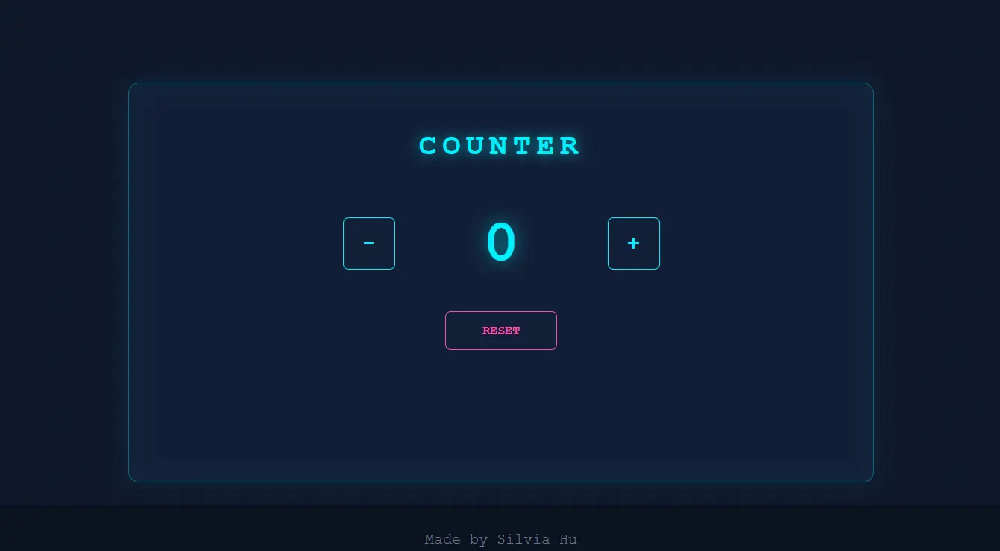

# Counter JS

A simple web application for counting, built with vanilla JavaScript.



🔗 **[Live demo](https://counter-js-yatomon96.netlify.app/)**

## How it works

- Increase the number with the **+** button
- Decrease the number with the **-** button
- Reset the counter to zero with the **Reset** button

## Technologies

- HTML
- CSS
- JavaScript (DOM manipulation and event handling)

## Project structure

```
counter-js/
├── index.html
├── assets/
├── css/
├── js/
└── README.md
```

## Run it locally

1. Clone the repository:
   ```
   git clone https://github.com/yatomon96/counter-js.git
   ```
2. Open `index.html` in your browser.

## What I learned

- Selecting and updating elements with the DOM
- Handling user events (`click`)
- Keeping the interface in sync with a variable

## Contact

- LinkedIn: [Silvia Hu](https://www.linkedin.com/in/silvia-hu-a84817412/)
- GitHub: [yatomon96](https://github.com/yatomon96)